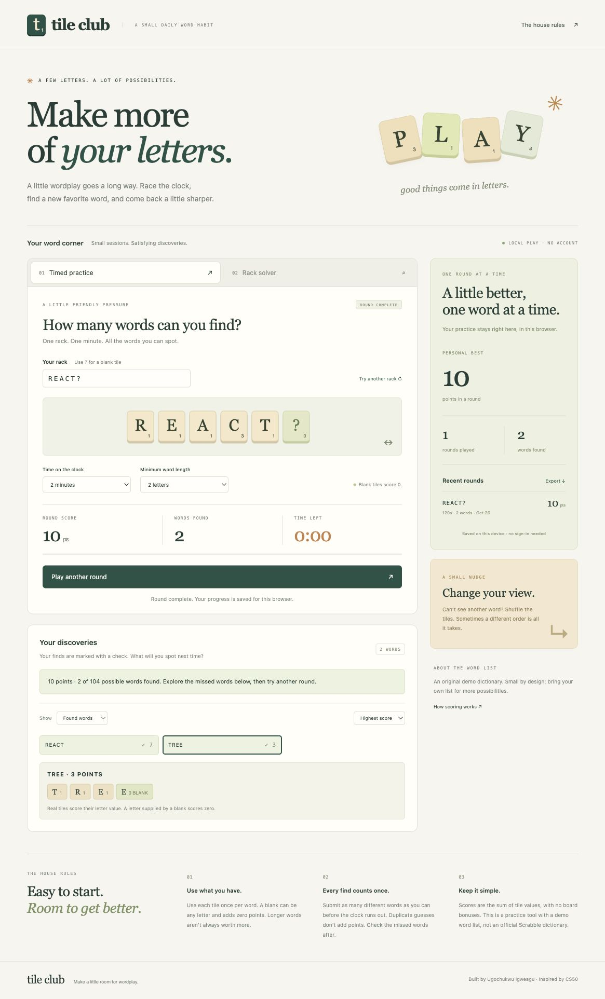

# Tile Club · Word Puzzle Trainer

**Make more of your letters.** A local word game with timed challenges, an untimed rack solver, blank-tile scoring, and saved practice progress.

Python validates words and runs the challenge clock. The browser provides the tiles, countdown, score explanations, and history. No accounts, third-party runtime packages, build step, or API keys.



## Run locally

Requires **Python 3.9+**.

```sh
git clone https://github.com/Ugo175/word-puzzle-trainer.git
cd word-puzzle-trainer
python3 server.py
```

Open **http://127.0.0.1:8769**. Stop with `Ctrl+C`. Use `python3 server.py --port 8770` if the default port is occupied.

## A one-minute demo

1. Keep the example rack `REACT?`. A question mark is a blank tile.
2. Choose a round duration: 30, 60, or 120 seconds. Set a minimum word length of two, three, or four letters.
3. Start a round and submit `react`: **7 points**. Submit it again: no extra points.
4. Submit `tree`: **3 points**, because the second E comes from the blank. An invalid word such as `zoo` is rejected for this rack.
5. Finish early or wait for the clock. See your final score, found words, and missed words. Select a word for a tile-by-tile score breakdown.
6. Refresh: completed-round history and your personal best remain in the same browser.
7. Try Rack solver with `QUI?`. `QUIZ` is worth **12 points** because Z uses the zero-point blank, rather than its usual ten-point tile.

Screenshots show real sample rounds played during verification. See the [demo checklist](docs/DEMO.md) and [mobile screenshot](docs/mobile.jpg).

## How it works

### Timed practice

Enter 1–12 letters, optionally including `?` blank tiles. Each tile can be used once in a word. The same rack is available again for each new word. The Python server checks guesses against the selected dictionary, available letters, and minimum length. A valid word scores once per round.

The server uses a monotonic deadline. Guesses received at or after the deadline do not count, even if a backgrounded browser displays a stale timer. The browser refreshes its display when the tab becomes visible. It automatically finishes the round when its countdown expires. Ending early is also allowed.

Rack settings and solver mode are locked during a round. Only found words appear while playing; all possible words and missed words appear afterward. This is a personal practice tool, not an anti-cheat or multiplayer service.

### Rack solver

Explore playable words without a timer. Sort by score, length, or alphabetically. Choose a word to inspect individual letter points and see which letters use blanks. The solver shares the CLI's word validation and scoring implementation.

### Scores

Letter values match those used in the CS50 Scrabble exercise. Blank tiles score zero. Real matching tiles are used before blanks. Scores are simple sums, without board multipliers or a seven-tile bonus. Case is normalized in the browser; the internal API expects lowercase ASCII letters.

### Saved progress

The browser keeps the most recent **200 completed rounds** in localStorage under `tile-club-history-v1`. Personal best, rounds played, and total words refer to this retained history and include all durations and racks. The four latest rounds appear in the sidebar. Export downloads the retained history as JSON.

Browser history is separate from CLI history. It is specific to this browser and origin (host and port); changing from `127.0.0.1` to `localhost`, changing ports, or clearing browser data changes which history you see. If storage is blocked, full, or corrupt, the game falls back to session-only progress and shows a notice. Export before closing to keep a copy.

Active rounds live in server memory and do not survive a server restart or page refresh. Abandoned rounds are not added to history. Round records are pruned after ten minutes when another round starts; at most 100 recent in-memory rounds are retained. Completed results cannot be scored again.

## Dictionary

The bundled `words.txt` is a small original demonstration list, **not a complete or official Scrabble dictionary**. A real word can be rejected if it is not in the selected list. Bring a larger UTF-8 dictionary containing one ASCII word per line:

```sh
python3 server.py --dictionary /path/to/words.txt
```

The CLI supports the same option. Words are case-normalized and deduplicated on load; invalid dictionary entries are rejected. No third-party dictionary or service is downloaded by the app. The preset racks are examples, and a custom dictionary might not contain words for every preset.

## Command-line tools

```sh
python3 trainer.py solve --rack 'react?'
python3 trainer.py practice --rack react --seconds 60 --progress progress.json
python3 trainer.py stats --progress progress.json
python3 trainer.py solve --rack example --dictionary /path/to/words.txt
```

The CLI solver includes one-letter entries if present; the browser defaults to a two-letter minimum. During terminal practice, time is checked when Enter is pressed because terminal input blocks. The browser has an automatic countdown. The default CLI history is `~/.word-puzzle-trainer.json`; browser history does not read or write this file. CLI history updates use atomic replacement and do not support concurrent writers.

## Architecture

```text
web/ → local HTTP API → server.py → game.py → trainer.py + words.txt
                                               ↑
                                      command-line tools
```

`trainer.py` provides rack validation and scoring; `game.py` adds tile explanations and thread-safe, server-timed rounds. `server.py` uses only the Python standard library, binds to loopback, serves a fixed asset list, rejects foreign hosts/origins, and limits request bodies to 2 MiB. The plain JavaScript frontend uses DOM text nodes for dynamic text and has no external assets or fonts.

The local server is for trusted, personal use. It is not a public production server, competitive ranking system, or authentication service. Browser storage can be edited by its owner. Rounds and scores are not intended as tamper-proof records.

## Verification

```sh
python3 -m unittest discover -s tests -v
```

The **15 tests** cover blank tiles, repeated letters, dictionary loading, CLI history, timed guess boundaries, duplicate guesses, idempotent completion, hidden solutions during play, round isolation and expiry, input limits, solver parity, and HTTP handling. Deadline tests use a fake monotonic clock; HTTP tests briefly bind a local server.

Browser checks cover an actual round, duplicate and invalid guesses, early completion, automatic expiry, solver mode, blank-tile explanations, filters, saved history after refresh, JSON export, and mobile layout. See [docs/DEMO.md](docs/DEMO.md).

## Future work

Optional larger dictionaries, personal bests by rack and duration, accessible definitions from a licensed source, and progress import.

## Origins

Created by **Ugochukwu Igweagu**, inspired by the Scrabble exercise in [my CS50 projects collection](https://github.com/Ugo175/projects). This standalone project adds rack solving, timed rounds, blank tiles, a browser game, score explanations, and local progress. See [ATTRIBUTION.md](ATTRIBUTION.md).
